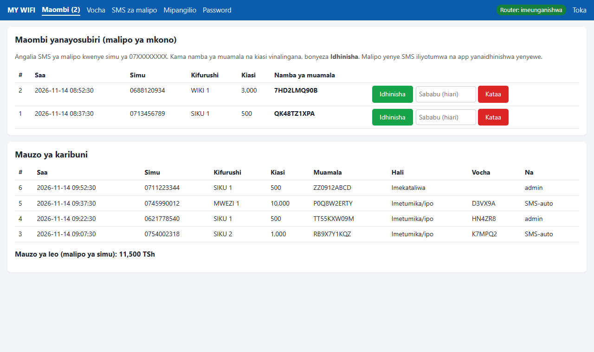
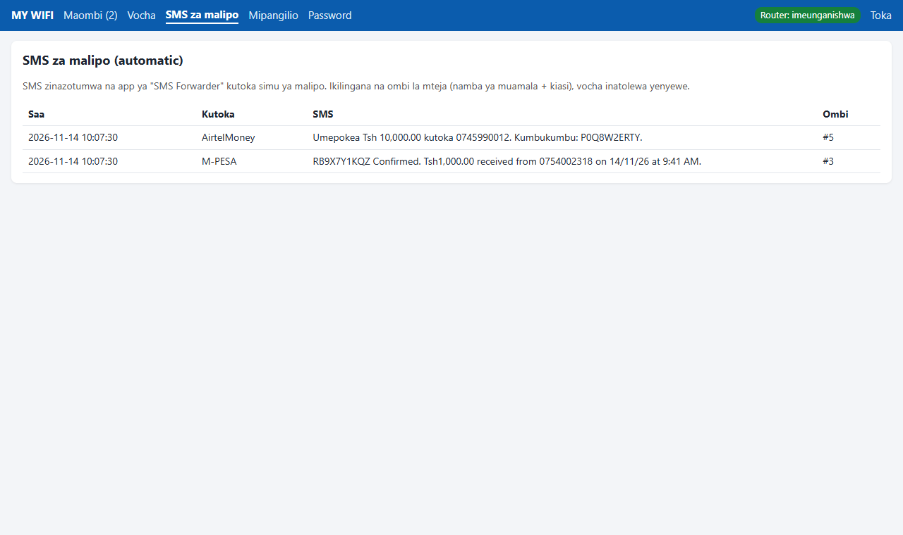
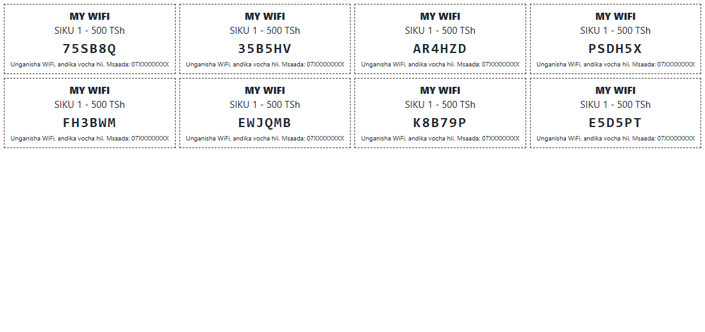

# WiFi Hotspot Admin

Server side of a pay-as-you-go WiFi business on a **MikroTik hotspot**: customers buy a package from the captive
portal, payment is confirmed **manually** (admin clicks *Approve*) or **automatically** (the payment SMS is forwarded
to the server and matched), and the router creates the hotspot user by itself within seconds.

Works with the customer page in **[wifi-hotspot-portal](https://github.com/massawes/wifi-hotspot-portal)**.

| Orders | Payment SMS | Printed vouchers |
|---|---|---|
|  |  |  |

## How it works

```
 Customer phone (captive portal)            Server (this repo)                 MikroTik router
 ───────────────────────────────            ──────────────────                 ───────────────
 BUY -> pays to mobile money number
 enters phone + transaction ID   ──POST──>  api/order.php  (pending)
                                            ├─ admin clicks Approve       (manual)
 payment SMS on owner's phone ─forwarder─>  └─ api/sms.php matches ref+amount (automatic)
                                               -> voucher code created (approved)
                                            api/router_pull.php  <──fetch every 15 s──  script vwifi-pull
                                            api/router_ack.php   <──────────────────── user added (active)
 portal polls api/status.php  <───────────  username/password
 auto-login (HTTP-CHAP)  ───────────────────────────────────────────────────────────>  hotspot login
```

* **No inbound connection to the router** – the router pulls work over HTTPS, so it can sit behind NAT/CGNAT with no VPN.
* **One payment = one voucher** – unique transaction IDs, atomic approval, router acknowledgement.
* **Automatic payments without a payment-gateway account** – an Android SMS forwarder posts payment SMS to
  `api/sms.php`; an order is approved only if its transaction ID *and* an amount ≥ the price appear in the SMS.
* **Manual vouchers** – generate batches, print 4-per-row cards.
* **Validity from first login** – router user profiles use Mikhmon-compatible on-login scripts, so the
  same router can also be managed with Mikhmon.
* Data (SQLite) and secrets live **outside the web root**; admin uses password hashing, CSRF tokens and a
  one-time setup code.

## Stack

PHP 8 (no framework), SQLite (PDO), RouterOS 6/7 scripting, vanilla JS on the portal.

## Install

```bash
# Ubuntu + Apache + PHP 8 with pdo_sqlite
sudo ./install.sh /var/www/html/wifi-hotspot-admin
```

1. Open `https://YOUR-SERVER/wifi-hotspot-admin/admin/`, enter the `SETUP_CODE` from
   `/var/lib/vicentwifi/secrets.php` and create the admin account.
2. Set business name and payment number under **Mipangilio** (settings).
3. Router: create the hotspot and the user profiles (`tools/router_setup.php`, or Mikhmon), then paste
   `router/vwifi-pull.rsc` with your `SERVER` and `ROUTER_KEY`.
4. Packages are listed in `VW_PACKAGES` (lib.php); the keys must equal the router user-profile names.
5. Optional automatic payments: install *Incoming SMS to URL forwarder* (F-Droid) on the phone that receives
   payments, sender `*`, text filter `(?i)(tsh|tzs)`, webhook `https://YOUR-SERVER/wifi-hotspot-admin/api/sms.php?key=SMS_KEY`.

## API

| Endpoint | Who | Purpose |
|---|---|---|
| `GET api/info.php` | portal | business name, payment number, packages |
| `POST api/order.php` | portal | `phone`, `package`, `pay_ref`, `mac` → order id |
| `GET api/status.php?id=&phone=` | portal | `pending` / `approved` / `active` (+ credentials) / `rejected` |
| `GET api/router_pull.php?key=` | router | next approved voucher: `id,user,pass,profile` or `none` |
| `GET api/router_ack.php?key=&id=` | router | voucher created on router → `active` |
| `POST api/sms.php?key=` | SMS forwarder | `{"from","text"}` → auto-match |

The admin interface is in Kiswahili (Tanzania).

## Author

Vincent Massawe – [github.com/massawes](https://github.com/massawes)
